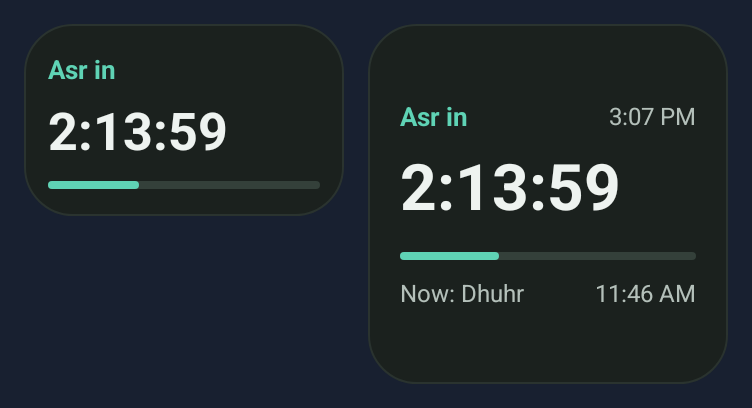
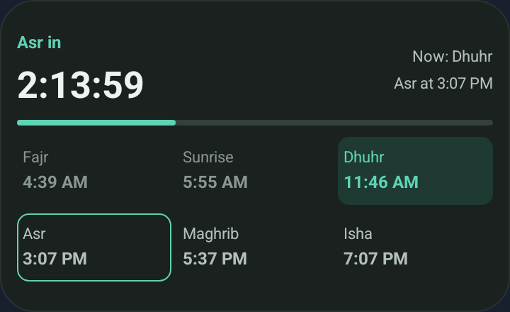
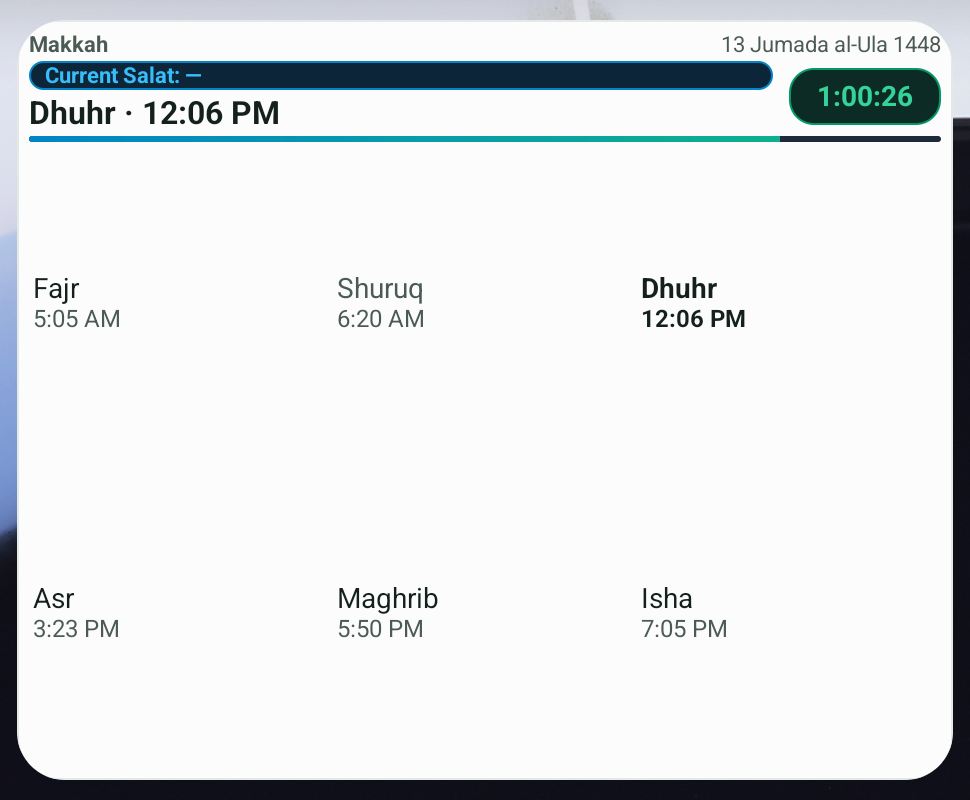

<p align="center">
  
</p>

<h1 align="center">Muajjin</h1>

<p align="center">
  <strong>Prayer times on your Android home screen.</strong>
</p>

<p align="center">
  An independently maintained fork of
  <a href="https://github.com/MuslimTechnician/muajjin">Muajjin by MuslimTechnician</a>,
  adding Android home-screen widgets and improving location setup, offline
  scheduling, and day-to-day reliability. This is not an official upstream release.
</p>

<p align="center">
  <a href="https://github.com/eval19/muajjin/releases"><strong>Download Android APK</strong></a>
  &middot; <a href="#what-this-fork-adds">What's different</a>
  &middot; <a href="https://github.com/MuslimTechnician/muajjin">Original project</a>
</p>

## Widgets in action

<p align="center">
  
  <br>
  <em>Strip and Square — compact, countdown-led native layouts.</em>
</p>

<details>
<summary><strong>See the wide card and full daily table</strong></summary>

**Wide card** — the next-prayer countdown and daily schedule in one widget.

<p align="center">
  
</p>

**Full daily table** — location, Hijri date, countdown, and the day's times.

<p align="center">
  
</p>

</details>

Native renders from the current development source on Android 16 (API 36), at
2× display density and font scale 1.0. These use synthetic layout fixtures, not
prayer-time reference data or a published APK; the first image combines two native
views. Launcher allocation, insets, system corners, and fonts affect actual
appearance. Equivalent usable bounds share the same visual hierarchy, not a
promise of identical screenshot pixels on every phone.

[Actual Pixel Launcher capture](docs/images/widget-launcher-api36.png): Full Table
from the development debug build, using a synthetic Makkah fixture and 24-hour
clocks. Two Wide instances on separate home pages retained independent 3×2 and
six-column compositions; host-size changes, theme changes, and tap-to-open were
observed.

Native visual checks cover all seven variants on API 36, both resource themes,
2×/3× density, English/Bengali/Arabic RTL, and font scales 1.0/1.3/1.5/2.0 at
appropriately enlarged bounds. From API 26 the native widget uses IBM Plex Sans
Arabic; API 24–25 retain the platform typeface. Xiaomi/HyperOS, API 24–30, and a
real keyguard host were not available for runtime verification. The transparent
variants were reviewed in the native debug host on light, dark, and busy sample
backdrops.

## What this fork adds

### Prayer times at a glance

See prayer times without opening the app. Five home-screen layouts and two
transparent keyguard-oriented variants retain their stable provider identities:

| Layout | Fixed target cells | Requested initial minimum (dp) |
| --- | --- | --- |
| Strip | 2×1 | 110×40 |
| Square | 2×2 | 110×110 |
| Banner | 4×1 | 250×40 |
| Wide card | 4×2 | 250×220 |
| Full table | 4×3 | 250×220 |
| Lock Small | 2×1 | 110×40 |
| Lock Medium | 4×1 | 250×40 |

Cell counts and minimums are launcher hints, not guaranteed content bounds.
All seven widgets declare a fixed footprint (`resizeMode="none"`); launchers
should not offer resize handles. Widgets placed by an older resizable build keep
their host-stored footprint, so remove and re-add such an instance once after
updating. Minimum hints use the platform's 70dp cell convention: 110dp for two
columns and 250dp for four; 40dp for one row and 110dp for two, so launchers that
add the usual 30dp margin place the intended span. The Wide and Full Table retain
a 220dp height because their daily grid needs it. These are cell hints, not
content bounds; hosts can still allocate a different area because of grid size,
insets, or font scale, and the layouts keep their compact fallbacks. Larger font
scales, long countdowns, and imported labels may not fit a fixed cell; choose a
larger widget variant instead of resizing. An undersized Full Table keeps its
location, Hijri date, countdown, and current/next summary while hiding a daily
grid that cannot be rendered completely. A larger host allocation restores all
six daily entries. Lock-screen widget availability depends on Android and its
widget host; these two providers remain keyguard-only, not universally supported
home widgets. Their white text and restrained shadow remain wallpaper-dependent.
Picker artwork uses a sample backdrop; the live keyguard views remain transparent.

### Widget text size

**Settings → Display → Widget text size** offers exactly two scales on Android.
**Normal** keeps the shipped widget typography; **Larger widget text** multiplies
that resolved profile by 1.2 for every role — prayer names, countdowns, clocks,
context lines and schedule cells. The setting is stored with the app settings and
sent in the existing presentation payload, so changing it updates widgets without
recalculating prayer times or changing alarms. Notifications keep their own text.

Larger text never falls back to a *smaller* profile than Normal: the Normal
profile is chosen from the host bounds first, then enlarged, and only spacing
tightens if room is short. All values, cells and columns are retained; existing
stacked/compact compositions are reused rather than hiding information. A six-cell
single row keeps every prayer complete by using 1dp cell padding and, where a
clock must wrap, two lines. The two keyguard-only variants (Lock Small, Lock
Medium) stay at Normal: their fixed one-row host cannot hold a larger three-line
stack without dropping a value. A fixed footprint can still be too small for
very large system font scales, long imported labels or the smallest one-row
hosts — choose a larger widget variant rather than resizing. The Arabic hero
layouts keep the label and countdown on the reading edge — left in a left-to-right
language, right in Arabic — and the wider variants pair that hero with matched
opposite tracks so the card fills without an empty side. In the 2×1 the timer owns
the vertical weight, so its progress line always renders; when a short host cannot
hold label, timer and line together, the label is the part that yields.

The 288dp daily-widget content width was selected after native Bengali 12-hour
noon measurements at two densities: the full clock needs a 286dp three-column
budget with 4dp cell side padding. The provider's 250dp minimum width is the
four-cell launcher hint, not the content floor; the renderer verifies the usable
width. This is a tested reference floor, not a guarantee about every OEM font or
launcher. Existing instances do not adopt the new fixed footprint automatically.

### Progress colors and device numerals — 2.9.0 rebuild

The 2.9.0 replacement APK uses internal build **291**; the original build 290 does
not include these changes. Existing 2.9.0 users must download and install the
replacement manually: the in-app checker compares version names, not build codes.
The five home widgets retain an **elapsed-interval** progress bar: a fuller bar
does not mean more time remains. Its solid fill changes from green to muted gold,
amber, then soft rose-red as the displayed next event approaches. Countdown digits
remain neutral; the two transparent keyguard variants do not gain bars.

| Stage | Begins when remaining time is at most |
| --- | --- |
| Green | Before the thresholds below |
| Gold | Half the dated interval, capped at 30 minutes |
| Amber | One quarter of the interval, capped at 15 minutes |
| Soft red | One tenth of the interval, capped at 5 minutes |

The nearest stage wins at an exact threshold. These colors indicate proximity,
not a missed prayer or religious ruling; sunrise and Dhuhr follow the same policy.
Updates reuse the existing non-wakeup 60–300-second cosmetic cadence. Android
batching, Doze, force-stop, and OEM restrictions can delay a change or skip a short
stage; the native countdown can keep ticking while the bar retains its last color.
No per-second redraw or additional stage alarm is introduced.

Widget clocks, Hijri day/year, and ordinary host-native countdown numerals follow
the **device numbering locale**, including regional and explicit numbering
preferences, independently of the selected app/import language. Prayer names,
month names, AM/PM words, and layout direction retain their app/import owner;
the selected 12/24-hour policy is unchanged. For example, English labels with
`٣:٠٢ PM` are intentional on an Arabic-Indic-numbering device. Digits inside
user-provided location names or imported words are not rewritten.

Device-language changes reconcile through the offline native update path without
opening the WebView. Notifications keep their existing app-numbering policy.
The live Chronometer runs in its host: a launcher with its own locale override
can differ from the device, and public widget APIs cannot guarantee digit identity
on every OEM/custom host. This is not resolved by forcing English or disabling
native ticking.

Feature verification used API 36 native `RemoteViews` rendering/reapplication in
both themes at 2×/3× density, including enlarged text and independent app/device
locale fixtures. An actual Pixel Launcher Banner was checked with Arabic-Egypt
and English-US system locales, including an English per-app override: live digit
code points were inspected after a tick. An offline system-language change with
the WebView closed restarted native reconciliation without changing stored
schedule, calculation, or imported presentation data. Persian, Bengali, regional
Arabic, and explicit Latin-numbering-extension pairs were configured native
fixtures, not claims about physical devices offering every locale preference.

### Arabic interface

Arabic is a built-in language with a complete translation. The web interface
uses IBM Plex Sans Arabic (SIL Open Font License, included in
`public/fonts/`) with logical RTL spacing, mirrored dividers and borders, and
direction-aware arrows. Imported Arabic translations fill missing keys from the
built-in Arabic template instead of English, and Arabic Hijri months are
canonical even when an older import omits them. The same seven native widget
IDs are reused when the app language changes; no language-specific providers
are added. The app sends a presentation update to those existing IDs, and the
widget switches labels, direction, and type together. Native time strings are
bidi-isolated, and keyguard variants use the compact type scale.

### Smoother first-time setup

Revised Android permission handling and cancellable, time-bounded location requests
help avoid unnecessary waits during initial setup. Approximate location permission
is supported, and obsolete detection results cannot overwrite a newer choice.
Manual location entry remains available when GPS or network services are unavailable.

### Offline widget scheduling

Android renews prayer schedules locally so widgets can keep updating without
reopening the app or fetching prayer times from a server. Widgets and optional
notifications share the native schedule. Android permissions and power-management
restrictions still affect background delivery.

### Targeted reliability improvements

This fork also includes repairs to dated prayer-time boundaries, settings saves,
font and translation imports, and background lifecycle handling. Unnecessary hidden
updates stop when inactive; background alarms stop when no widgets or notifications
are active. These are specific work reductions, not a measured battery-life or
startup-speed guarantee.

## Built on the original Muajjin

[MuslimTechnician's Muajjin](https://github.com/MuslimTechnician/muajjin) provides
the foundation. This fork retains its core capabilities:

- Locally calculated prayer times and Suhoor/Iftar times.
- Current-prayer highlighting, next-prayer countdown, and Hijri date display.
- Qibla compass and Qaza tracking.
- Light and dark themes.
- Translation and font customization.

GPS detection and IP-based fallback also originate upstream. This fork improves
their handling rather than introducing automatic location detection as a new feature.
Credit for the original app belongs to its upstream authors and contributors.

## Install and add a widget

Requires **Android 7.0 or newer**.

1. Open [this fork's Releases](https://github.com/eval19/muajjin/releases) and
   download the signed **`.apk`** asset. Do not install a source-code archive,
   an Actions ZIP, or a file ending in `-unsigned.apk`.
2. Open the APK and follow Android's installation prompts. If required, allow
   installation from the browser or file manager you used.
3. Open Muajjin and complete location and prayer settings. Use automatic detection
   or enter your location manually.
4. Long-press an empty area of your Android home screen, open **Widgets**, find
   **Muajjin** or **Prayer Times**, and drag a layout onto the home screen.
   Widget-picker labels and resizing controls vary by launcher.

**Updating an existing installation:** compatible package identity and signing
certificates are required. This fork is not automatically a drop-in update for an
APK from the original project or another distributor. Do not uninstall an existing
app as a workaround: its local settings, Qaza history, and customizations may be lost.

**Background limits:** exact-alarm or notification permission denial, Android Doze,
and manufacturer power management can delay delivery. Exact-alarm denial uses an
inexact fallback plus one non-wakeup recovery refresh shortly after the boundary.
Display Settings → Widget reliability shows both permissions and the next/last
update times. Force-stopping the app suspends background delivery until it is
reopened; a powered-off device cannot deliver notifications. Ordinary app closure
does not require the WebView to remain running for native schedule renewal.

## Privacy and offline use

Prayer and fasting times are calculated locally. Android can renew widget schedules
offline. No account or login is required.

Automatic location setup can contact external services: GPS address lookup sends
coordinates to OpenStreetMap Nominatim, and IP fallback providers receive your IP
address. Manual location entry avoids those lookups. GitHub-distribution builds
also use the network for update checks and downloads.

The browser version has **no service worker or guaranteed offline cold-load cache**.
Local calculations do not mean the website can always open without a connection.
See the [Privacy Policy](docs/PRIVACY_POLICY.md) for storage, permissions, and
network-service details.

## Development

Built with React 18, TypeScript, Vite, Tailwind/Radix, and Capacitor 8.
Use Bun **1.2.2** and Node **22.12+**.

```bash
# Install locked dependencies
bun install --frozen-lockfile

# Start the development server
bun run dev

# Build the standard distribution (GitHub updater disabled)
bun run build

# Build the GitHub distribution (includes update checker)
bun run build:github

# Lint, app/tooling TypeScript, regressions, and both web builds
bun run validate
```

Vite alone does not type-check. Native builds require JDK **21**, SDK **36**,
build-tools **36.0.0**, and the Gradle **8.14.3** wrapper. Build the intended web
mode before Capacitor sync.

<details>
<summary><strong>Calculation, storage, and lifecycle implementation notes</strong></summary>

Prayer instants remain dated; clocks and civil grids follow the **device timezone**.
Tomorrow's Fajr is calculated rather than copied. Zero coordinates are valid;
damaged saved coordinates require repair without replacing valid preferences.
Unsupported astronomical/Hijri results are reported, not guessed.

Visible countdowns retain seconds; hidden cosmetic work and inactive compass
sampling stop. Native widgets and notifications share one update snapshot.
Required transition alarms are separate from non-wakeup cosmetic refresh.

Settings commit before success/navigation; failed saves preserve the working value.
Font migration moves verified binaries into IndexedDB and retains legacy data until
durable readback. Imports are validated and bounded, with protection against
obsolete requests activating stale selections.

The native handoff separates acknowledged calculation and presentation revisions,
reuses valid status, and retries failed delivery. All seven provider identities are
retained. The full daily widget uses a bounded three-column, two-row table. Wide
cards prefer six columns when complete labels/clocks fit; otherwise they reflow
to three columns and two rows. Shallow legacy sizes may use uniformly reserved
two-line clock slots, never one accidentally taller AM/PM tile. At tightly
constrained three-column widths, shared side padding is fitted in native pixels,
down to a 1dp floor. Schedule clocks never shrink below 12sp or lose localized day
periods; impossible bounds still require a larger widget variant or launcher cell.
All seven widgets retain native Chronometers, existing prayer-state meaning,
whole-widget tap behavior, and the shared schedule/update pipeline.

Implementation decisions and recorded verification:
[plan](tasks/plan.md), [checklist](tasks/todo.md), and
[evidence and limits](tasks/evidence.md). These include measured work reductions,
bundle-size increases, device checks, and rollback caveats; they are not a claim of
universal device support or measured battery-percentage/startup improvements.

</details>

---

## Android Build

<details>
<summary><strong>Signing, APK Build, and Reproducible Verification</strong></summary>

### Keystore Setup

Only required for deliberate signed release builds. The local release package scripts and default CI runs produce **unsigned** verification artifacts, which Android cannot install. Local signing requires `-PsignRelease=true`; GitHub signing uses the explicit manual option below. Never commit a keystore, password or `android/local.properties`.

1. Place your keystore file in:

```
android/app/
```

2. Create or edit `android/local.properties`:

```properties
keystore.file=app/your-keystore.keystore
keystore.password=your_password
keystore.key.alias=your_alias
keystore.key.password=your_key_password
```

### Build APK

```bash
# Debug APK (larger, faster build)
bun run android:build

# Unsigned release APK (optimized, smaller)
bun run android:release

# Unsigned GitHub-mode release APK (includes update checker)
bun run android:release:github
```

**APK Output Directory**

```
android/app/build/outputs/apk/
```

### Installable APK from GitHub Actions

For installation, use the signed `.apk` on
[this fork's Releases page](https://github.com/eval19/muajjin/releases),
not a source archive, Actions ZIP, or `*-unsigned.apk`. Updates to an existing
installation must retain its signing identity; upstream APK compatibility is
not established by this workflow.

Version 2.9.83 keeps the 2×1 progress line when Larger widget text is enabled. The
timer previously pushed the bar out of the card on short hosts, so the line
vanished; the timer now owns the vertical weight and the prayer label yields when
the host is too short for all three. The line and countdown always render, and the
label returns on taller hosts.

Version 2.9.82 restores reading-edge alignment for the 2×1 widget: the prayer
label and countdown sit on the left in a left-to-right language and on the right
in Arabic, with the progress bar filling from the same side. The regression now
asserts that edge instead of a centred axis; nothing else changes from 2.9.81.

Version 2.9.81 balances the existing seven widgets and adds one widget text-size
setting. The 2×1 strip puts its prayer label and countdown on the card's centre
axis instead of hugging one edge, and the wider variants keep matched
leading/trailing tracks and a six-cell row that preserves every prayer name.
Settings → Display → **Widget text size** offers exactly two scales: Normal keeps
the shipped typography while Larger multiplies the resolved profile by 1.2
without recalculating prayer times, changing alarms, or touching notifications. The
two keyguard-only variants stay Normal because their fixed one-row host cannot
hold a larger three-line stack. Arabic numerals still follow the device; the app
itself keeps Latin digits, so the two differ when the app and device languages
differ — that policy is unchanged by this release.

Version 2.9.8 refines Arabic typography, RTL controls, responsive app screens and
the existing seven Android widgets. Prayer names and clocks share consistent
alignment, compact/stacked layouts retain their content, and clock day-period
ordering is protected for Latin and Arabic-Indic digits. Widget numerals still
follow the device; there is no forced-English-digit policy or separate Arabic
widget. The progress palette and prayer calculations remain unchanged.
Native debug-host rendering passed in both themes; real launcher/keyguard
integration remains a device-verification limit, not a claimed pass.

Version 2.9.7 completes Arabic localization for both the web application and
the Android home-screen widgets. The web interface ships with a complete built-in
Arabic translation, an IBM Plex Sans Arabic font family, logical RTL layout,
bidi-safe prayer ranges, and automatic Arabic repair for imported translations.
Android widgets adopt IBM Plex Sans Arabic from API 26 with matching text
measurement, natural countdown phrasing, bidi-isolated clocks, and compact
keyguard scales, while keeping the same seven widget identities across language
changes.

Version 2.9.6 refines the Android 12+ home-screen widget progress colours with
the approved emerald → lime → yellow → orange → orange-red → red progression.
Both themes use identical timing: accent green holds through 4/11, yellow is
at 7/11, orange at 9/11, orange-red at 10/11, and red at the target.
Theme-specific tones differ, but the green-to-yellow transition is balanced
across three segments rather than concentrated in its last segment.
Only progress-fill colours and their duration within the existing timeline
change; calculations, countdowns, labels, track, layout, notifications and
refresh scheduling are unchanged. Android 7–11 retains its legacy palette.
All 52 native unit tests and three targeted API 36 rendering tests passed;
native anchor and halfway captures were inspected in both themes. This is
not physical-device, launcher, Doze or alarm-delivery verification.
Minimum sampled fill/track contrast remains 1.33:1 light / 3.29:1 dark;
the approved palette is preserved without claiming an accessibility pass.

Version 2.9.5 revises the twelve-anchor home-screen widget progress palette.
The first 1/11 matches the current-prayer text green: `#0B6E5B` light and
`#5FD3B5` dark. OKLab blending reaches yellow (`#EAB308` light / `#FACC15` dark)
at 6/11, shared orange `#FB923C` at 9/11, and red (`#DC2626` light /
`#EF4444` dark) at the target. Only the fill changes: Android 12/API 31+
receives the progression, while Android 7–11 keeps the existing four-stage
colours. Labels, track, countdowns, layouts, notifications and scheduling are
unchanged. Native unit tests and production-sampler smoke passed; actual Android
pixels for this revision remain unverified. Sampled minimum fill/track contrast
is 1.39:1 light and 2.88:1 dark; the exact selected colours are retained.

Version 2.9.3 improves prayer-transition reliability. Display Settings → Widget
reliability shows exact-alarm and battery-optimization state and links to the
system screens. The transition alarm re-arms after delivery, and a non-wakeup
recovery refresh runs about 15 seconds after the boundary if the exact update was
late or missed. The live seconds countdown, layouts, calculations, notifications,
and numerals are unchanged. Force-stop and OEM battery limits remain platform
constraints.

Version 2.9.1 fixes widget footprints. All seven widgets declare
`resizeMode="none"` and canonical launcher cell hints, so MIUI and other
launchers place the intended 2×1/2×2/4×1 spans at add time and do not offer a
resize handle. Existing placed instances keep their stored size until removed
and re-added. The 2.9.0 progress colors, device numerals, layouts, schedules,
calculations, and notifications are unchanged.

Version 2.9.0 refines all seven native widgets with consistent spacing,
typography, corners, and progress bars. Wide schedules reflow into equal-sized
cells; Full Table uses a bounded current-prayer highlight and the shared green
palette. Prayer calculations, native countdowns, alarms, and storage are unchanged.
Wide and Full Table requested at least 288×220dp in that release; their content
requirements and compact fallbacks are unchanged. Actual captures, tested
environments, and device limits are documented in the widget section above.

Version 2.8.4 completes the pending font/import, timezone, adjustment and
widget-sync corrections. Settings save only their own fields; responsive
resizing preserves drafts; Qibla subscriptions and update requests have
owned cleanup. Invalid native schedules recover without fabricated times,
and an unsupported Hijri adjustment does not discard other widget settings.
Exact exercised checks and device limitations are in `tasks/evidence.md`.

The release workflow supports **explicit manual signing**. Version 2.9.83
(Android versionCode 301) keeps `org.muslimtechnician.muajjin`; it does not
change the minimum Android version (7.0/API 24) or lower the target SDK.
Android 15/16 can reject an unsigned APK before the app ever launches.

Configure these repository Actions secrets yourself using the **existing signing
key for this fork's release line**, only after authorizing its use in GitHub:

- `ANDROID_KEYSTORE_BASE64`: base64 encoding of that release keystore.
- `ANDROID_KEYSTORE_PASSWORD`: its store password.
- `ANDROID_KEY_ALIAS`: the existing signing-key alias.
- `ANDROID_KEY_PASSWORD`: that key's password.
- `ANDROID_SIGNING_CERT_SHA256`: the independently confirmed signing
  certificate's SHA-256 fingerprint, with or without colons.

Do not substitute a newly generated key or the Android debug key. An update
must match the installed app's signing identity; changing keys can prevent
updates. Do not uninstall the existing app as a workaround: its local data
may be lost. Key provisioning, commits/pushes and publication are separate
authorized actions, not performed by preparing this workflow.

After the source changes are committed and pushed:

1. Open **Actions → Build release APK → Run workflow**.
2. Select the trusted source commit/tag in `ref`; enable **sign_release**.
3. Download the successful run's artifact
   `muajjin-2.9.83-301-github-release.apk`, extract the Actions ZIP, and install
   the **`.apk` inside it**, not the ZIP.

The signed path checks alignment, verifies the APK for API 24–36, requires
the pinned original certificate and records its checksum. Missing secrets,
invalid signatures or a different certificate fail the run without uploading
an unsigned substitute. Temporary decoded keys are removed on step exit.
No GitHub Release is created or modified automatically.

Tag builds and manual runs with **sign_release disabled** still produce
`*-release-unsigned.apk` for reproducibility checks only. These are **not
installable**. Debug builds use a separate `.debug` package and do not update
the release application.

### Controlled builds and signed-reference verification

```bash
# Explicit mode and actual source/build epoch; new output directory required.
bun run reproducible:build --mode github --time <epoch-seconds> --output <new-directory>

# All required inputs; verification is read-only and never rebuilds/signs.
bun run reproducible:verify --apk <signed-reference.apk> --local-apk <unsigned-local.apk> \
  --metadata <build-metadata.txt> --mode github --time <epoch-seconds> \
  --apksigner <SDK-apksigner-path> --certificate <independently-trusted-SHA256>
```

The build replaces `dist`/Capacitor-generated assets, cleans Android outputs and records source/toolchain inputs; `--install` explicitly permits a frozen dependency install. `--tag <local-tag>` requires matching HEAD and uses its commit epoch, not the release publication date. Dirty/untracked source must be disclosed.

Verification first validates the APK signature and independently trusted signer, then compares every uncompressed ZIP payload entry. Only verified standard v1 signature metadata is excluded; v2/v3 blocks are outside ZIP entries. **Payload equality is not whole-file bit identity**, pristine-source proof or an independently established release identity. A checksum supplied alongside an APK is not independent trust.

Native unit tests: `cd android && ./gradlew :app:testDebugUnitTest`. Assemble the application’s runtime tests with `:app:assembleDebugAndroidTest`; run them only on an explicitly selected authorized debug emulator/device with widget-bind and notification permission. Windows uses `gradlew.bat`.

</details>

---

## Contributing

This fork is maintained independently. Widget development and fork-specific
releases are maintained here; improvements that fit the original project's scope
may be proposed upstream. This does not imply upstream endorsement or acceptance.

For contributions to this fork, discuss substantial new features with the
maintainer before implementation. Bug fixes, performance improvements, and
localization contributions are welcome. Preserve existing features and privacy
behavior; do not expand network access or background activity incidentally.

For contributions to the original app, follow
[upstream's contribution policy](https://github.com/MuslimTechnician/muajjin#contributing):
bug fixes and performance improvements are welcome, while new features require
discussion first. Prefer focused fixes against current upstream rather than a
single pull request containing this fork's widgets, branding, and release changes.

---

## License

Released under the [MIT License](LICENSE). Original Muajjin copyright:
**Copyright (c) 2025 MuslimTechnician**. The original license and copyright notice
are retained.
