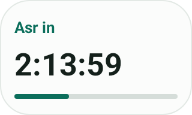

<p align="center">
  
</p>

<h1 align="center">Muajjin</h1>

<p align="center">
  Offline prayer times, fasting times, Qibla, and an Android home-screen widget without ads, accounts, or tracking.
</p>

<p align="center">
  An independently maintained fork of
  <a href="https://github.com/MuslimTechnician/muajjin">Muajjin by MuslimTechnician</a>.
  It keeps the original app's local calculations and clean layout while adding a native Android widget, ongoing countdown notification, offline schedule renewal, Arabic support, and reliability fixes.
</p>

<p align="center">
  <a href="https://github.com/eval19/muajjin/releases"><strong>Download Android APK</strong></a>
  &middot; <a href="#how-this-fork-differs-from-the-original">Original vs. this fork</a>
  &middot; <a href="#features">Features</a>
  &middot; <a href="#development">Build from source</a>
</p>

<p align="center">
  
  &nbsp;&nbsp;
  
</p>

## What Muajjin does

Muajjin calculates daily Salat and Saum times directly on your device from your coordinates. After location setup, daily schedules, Hijri dates, Qaza counts, and Qibla calculations run offline with no sign-in and no analytics.

## How this fork differs from the original

[MuslimTechnician's Muajjin](https://github.com/MuslimTechnician/muajjin) handles the core web and Capacitor app. This fork builds on top of it for everyday Android use:

| Area | Original Muajjin | This fork |
| --- | --- | --- |
| Home-screen widget | None | Native 2x1 resizable Android widget with live countdown and color-shifting progress bar |
| Lock-screen countdown | None | Ongoing countdown notification with Android 15/16 Live Update chip support where available |
| Offline Android renewal | Needs the app opened | Native Java prayer and Hijri engine keeps a 30-day schedule and renews it offline |
| Languages | English, Bengali, custom imports | Adds built-in Arabic with RTL layout and IBM Plex Sans Arabic |
| Location setup | GPS and IP fallback | Cancellable, time-bounded requests with approximate location support |
| Diagnostics | None | Widget reliability screen showing exact-alarm and battery status, last refresh, and next update |
| Power and lifecycle | Standard React timers | Event-driven boundary updates; native alarms cancel when no widget or notification is active |

## Features

### Android widget and live notification

- A 2x1 Strip widget (`110x40dp` minimum, horizontally and vertically resizable) displays the next prayer label, a live seconds countdown, and an elapsed-interval bar.
- On Android 12 and newer, the progress bar blends smoothly from green through gold and amber to soft rose-red as the next prayer gets closer. Android 7 through 11 use a four-stage color bar.
- Within the last 15 minutes before Fajr, Sunrise, Asr, Maghrib, or Isha, the label switches to a warm amber color.
- Light, dark, and system theme settings apply to the widget without recalculating schedules. Display settings also include a 1.2x larger widget text option.
- Widget clocks and Hijri numerals follow your device numbering preference independently of the app language, so Arabic-Indic or Bengali digits work even when labels are in English.
- On Android, an ongoing notification keeps the next prayer countdown visible in the shade and lock screen, and uses Android 15/16 promoted Live Update chips when supported by the system.

### Daily prayer and fasting tools

- Eleven calculation methods (Karachi, ISNA, Muslim World League, Umm al-Qura Makkah, Egyptian, Tehran, Dubai, Kuwait, Qatar, Singapore, and Moonsighting Committee Worldwide) plus Shafi'i/Maliki/Hanbali and Hanafi Asr options.
- Current prayer progress bar, next prayer card, full daily timetable with custom Jama'ah times, and prohibited prayer windows (Shuruq, Zawal, Ghurub).
- Suhoor end and Iftar start times with individual +/- 10 minute adjustments.
- Upcoming timetable to check prayer times for any single date or full month between 1900 and 2100.
- Qibla compass using device orientation sensors, with numeric bearing display when sensors are unavailable.
- Qaza tracker for logging missed prayers per prayer with quick +/- steps or direct number entry.
- Umm al-Qura Hijri calendar (1900 to 2077) with a Maghrib date-rollover toggle and manual day offset.

### Customization and languages

- Drag-and-drop reordering and visibility toggles for every card on the home screen.
- Light, dark, and system themes plus 12-hour or 24-hour time formatting.
- Built-in English, Bengali, and Arabic translations, with JSON translation import and `.woff2` custom font uploads stored locally in IndexedDB.

## Install on Android

Requires Android 7.0 (API 24) or newer.

1. Open [Releases](https://github.com/eval19/muajjin/releases) and download the signed `.apk` file (skip source archives, Actions ZIPs, or files ending in `-unsigned.apk`).
2. Open the APK on your phone and allow installation from your browser or file manager if prompted.
3. Open Muajjin and finish location and calculation setup, using automatic detection or manual latitude/longitude entry.
4. Long-press an empty space on your home screen, open **Widgets**, find **Muajjin**, and place the Strip widget.

Updating an existing install requires a matching signing certificate. Because this fork uses its own signing key, it will not install directly over an APK from the original project or another distributor. Do not uninstall an existing copy as a workaround, because Android removes local settings, Qaza counts, and custom fonts when an app is uninstalled.

Android power management and exact-alarm permissions affect background refreshes. In the app, **Settings -> Display -> Widget reliability** shows whether exact alarms and unrestricted battery usage are enabled, along with the last refresh and next transition time. Force-stopping the app pauses widget and notification updates until you open it again.

## Privacy and offline use

Muajjin has no user accounts, no ads, and no analytics. Your settings, Qaza counts, custom fonts, and imported translations stay on your device.

A few optional features use the network:

- Automatic GPS lookup sends coordinates to OpenStreetMap Nominatim to resolve your city and country name.
- IP-based location fallback contacts `ip-api.com` or `ipwhois.app`, which see your IP address.
- GitHub-mode builds check GitHub Releases for app updates.

Entering coordinates manually keeps location setup completely offline. Note that the browser web build does not include a service worker, so opening it in a web browser still requires an internet connection on load. See the [Privacy Policy](docs/PRIVACY_POLICY.md) for full details.

## Development

Built with React 18, TypeScript, Vite, Tailwind CSS, Capacitor 8, and a native Java schedule/widget layer on Android. Tooling uses Bun `1.2.2` and Node `22.12+`.

```bash
# Install locked dependencies
bun install --frozen-lockfile

# Start local dev server
bun run dev

# Build web app (standard mode, updater disabled)
bun run build

# Build web app (GitHub mode, updater enabled)
bun run build:github

# Run lint, TypeScript checks, unit tests, and both web builds
bun run validate
```

Android builds require JDK 21, Android SDK platform 36, build-tools 36.0.0, and the checked-in Gradle 8.14.3 wrapper. Build the web mode you want before running `bun run sync:android`.

<details>
<summary><strong>Android builds, signing, and verification commands</strong></summary>

Unsigned release APKs are produced by default so builds remain reproducible without local secrets. Only signed APKs can be installed on Android.

```bash
# Debug APK (standard or GitHub mode)
bun run android:build
bun run android:build:github

# Unsigned release APK
bun run android:release
bun run android:release:github

# Native Android unit tests
cd android && ./gradlew :app:testDebugUnitTest

# Controlled unsigned release build and verification
bun run reproducible:build --mode github --time <epoch-seconds> --output <new-directory>
bun run reproducible:verify --help
```

To sign locally, add your keystore settings to `android/local.properties` (never commit keystores or `local.properties`) and pass `-PsignRelease=true`. For GitHub Actions signing, use **Actions -> Build release APK -> Run workflow** with **sign_release** enabled and the repository signing secrets configured. Implementation decisions and recorded test runs are kept in [tasks/plan.md](tasks/plan.md) and [tasks/evidence.md](tasks/evidence.md).

</details>

## Contributing and license

Bug fixes, reliability improvements, and translations are welcome. Discuss larger feature changes in an issue first, and avoid adding unnecessary network requests or background work. Fixes that belong to the core app rather than this fork's widgets and native engine can also be proposed upstream to [MuslimTechnician/muajjin](https://github.com/MuslimTechnician/muajjin).

Released under the [MIT License](LICENSE). Original Muajjin copyright (c) 2025 MuslimTechnician.
